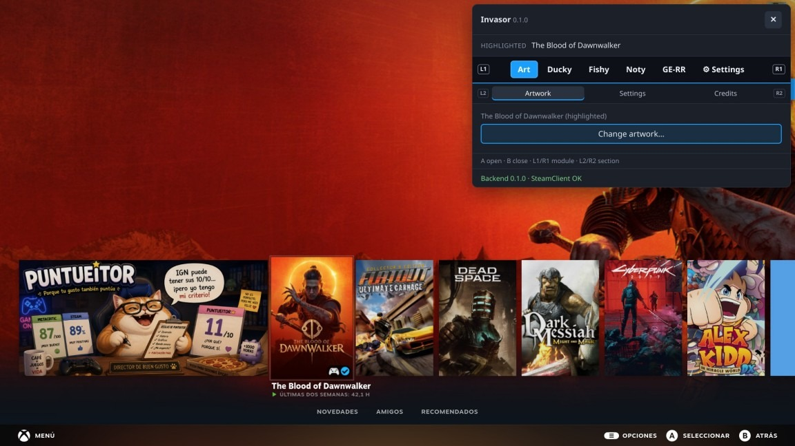
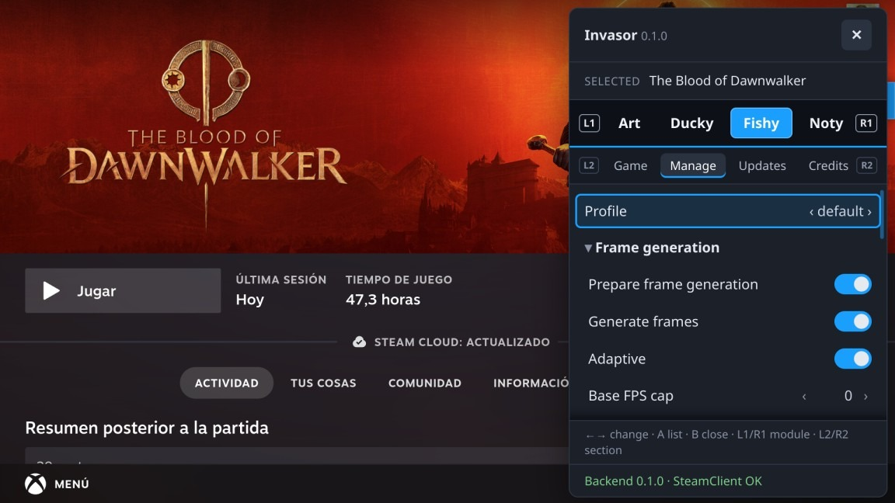
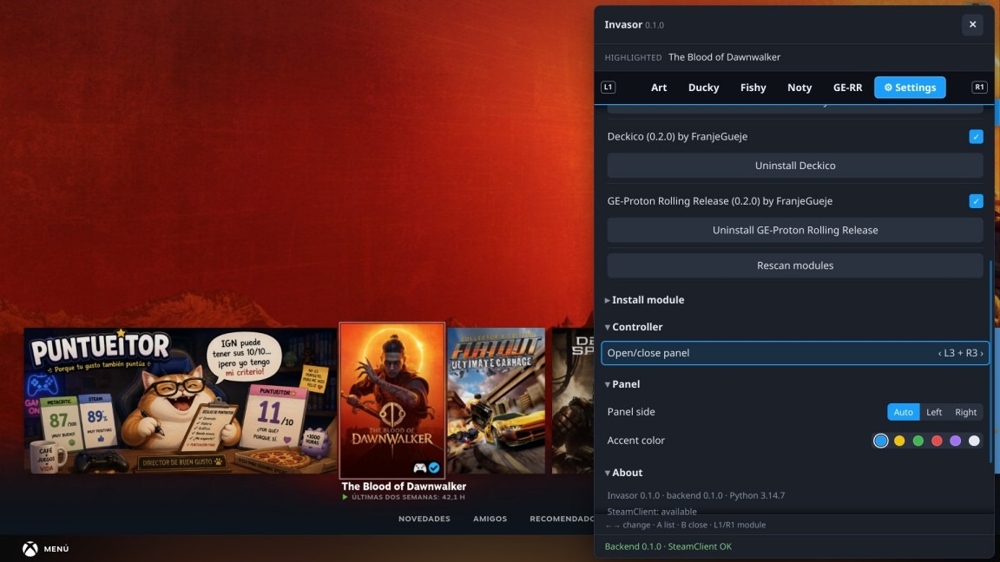

  

# Invasor

[English](https://github.com/Gamemode-Invasor/.github/blob/main/profile/README.md) · **Español**

*Un pequeño panel que vive dentro de Steam, pensado para usarse con el mando desde el sofá.*

Una alternativa a Decky Loader, diseñada para romperse menos y sobrevivir a las actualizaciones de Steam. Invasor no
pretende competir con Decky Loader ni destronarlo: es simplemente una alternativa ligera y sencilla.

  

## ¿Qué es?

Invasor añade una pestaña más a la interfaz de mando de Steam (**Game Mode** y **Big Picture**), en la Steam Deck,
la Legion Go, otras portátiles o cualquier PC con Linux y Game Mode. Pulsa **L3 + R3** y se abre el panel. Ciérralo y
vuelves a tu juego.

Dentro, cada función es un **módulo** independiente. Usa los que te gusten y apaga los que no.

## Un vistazo

   
  <em>Opciones de generación de fotogramas para el juego que tienes seleccionado.</em>

   
  <em>Ajustes: enciende y apaga módulos, instala otros nuevos y elige cómo abrir el panel.</em>

## Algunos módulos

| | |
|---|---|
| **[Artwork](https://github.com/Gamemode-Invasor/invasor-artwork)** | Busca imágenes de la comunidad para tus juegos y accesos directos y ponlas sin levantarte del sofá. |
| **[Deckico](https://github.com/Gamemode-Invasor/invasor-deckico)** | Pone el icono de cada juego en sus carpetas ocultas de Proton, para saber cuál es de qué juego. |
| **[Ducky](https://github.com/Gamemode-Invasor/invasor-ducky)** | Generación de fotogramas por juego, con lsfg-vk. Elige un perfil y a jugar. |
| **[Fishy](https://github.com/Gamemode-Invasor/invasor-fishy)** | Lo mismo con MAKO Renderer: generación de fotogramas y escalado por juego. |
| **[GE-RR](https://github.com/Gamemode-Invasor/invasor-ge-rr)** | Mantiene el último GE-Proton instalado con un solo nombre, para no tener que volver a elegirlo tras cada actualización. |
| **[Noty](https://github.com/Gamemode-Invasor/invasor-noty)** | Muestra notificaciones de Steam desde tus propios scripts. |

## ¿Por qué Invasor?

- **Hecho para sobrevivir a las actualizaciones.** No se apoya en el funcionamiento interno de Steam. Como todo lo que se
  engancha a Steam, se puede romper, pero no es tan frágil como otras herramientas parecidas.
- **Ligero.** Con todo cargado usa unos 38 MB de memoria y alrededor del 1 % de un núcleo de CPU.
- **Sin contraseña de administrador.** Funciona con tu usuario y nunca pide root.
- **Un módulo roto no rompe a los demás.** Si un módulo falla, solo se ve afectada su propia pestaña.

## Pruébalo

1. Descarga la última versión desde el [repositorio de Invasor](https://github.com/Gamemode-Invasor/invasor).
2. Descomprímela y haz doble clic en el instalador.
3. Reinicia Steam una vez. Y ya está.

Las instrucciones paso a paso están en el README de ese repositorio. Los módulos se instalan desde un zip, en los
ajustes del propio panel.

## Crea tu propio módulo

Un módulo puede ser tan pequeño como un solo archivo de ajustes. Hay una plantilla para empezar y una guía que lo
explica todo: mira [cómo escribir un módulo](https://github.com/Gamemode-Invasor/invasor/blob/main/docs/MODULES.md)
(en inglés). La plantilla tiene licencia MIT, así que puedes partir de ella con la licencia que quieras.

## La letra pequeña

- Invasor es software libre, con licencia GPL-3.0-or-later.
- Un módulo es código que se ejecuta en tu dispositivo: instala solo los de personas en las que confíes.
- Invasor no está afiliado con Valve, SteamGridDB, lsfg-vk, MAKO, GloriousEggroll ni con ningún proyecto con el que
  trabajen sus módulos. Por favor, no les reportes problemas de Invasor ni de sus módulos.
- Por transparencia: en algún momento de este proyecto se han utilizado herramientas de IA. Las ha dirigido y
  orquestado un ingeniero con experiencia, que toma todas las decisiones de arquitectura y de diseño.
- Hecho por [FranjeGueje](https://github.com/FranjeGueje).
